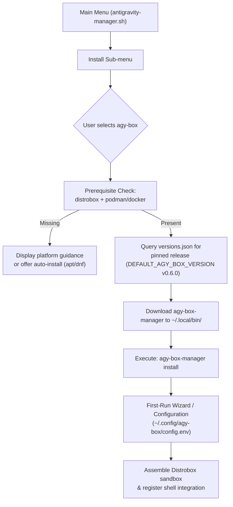

# Implementation Plan — `agy-box` v0.6.0 Integration in `agy-easy-install`

> **Status:** ✅ Implemented & Active  
> **Last updated:** 2026-10-10 · Synced with `agy-box` v0.6.0  
> **Parent:** [implementation_plan.md](implementation_plan.md) · [master-plan.md](master-plan.md)

---

## Goal

Integrate the **Antigravity Developer Sandbox (`agy-box` v0.6.0)** as a native, first-class installation choice inside the `agy-easy-install` interactive menu and automated CLI runner.

`agy-box` delivers a fully isolated, containerized OCI environment on top of Distrobox, packaging the Antigravity toolchain (`agy` CLI, Python SDK, Google ADK, Gemini CLI), VDI desktop (IceWM), pre-baked modern editors (VS Code, Zed), on-demand JetBrains IDE integrations, and local Web UI dashboards without polluting the host OS.

---

## Multi-Architecture Container Architecture

The containerized sandbox utilizes an immutable OCI image published to the GitHub Container Registry:

* **Image:** `ghcr.io/wtg-codes/agy-box:v0.6.0` (also tagged `:0.6` and `:latest`)
* **Base Image:** `ghcr.io/ublue-os/ubuntu-toolbox` (Ubuntu 26.04 LTS), pinned by digest for supply-chain integrity
* **Architecture:** Published multi-arch container targeting `linux/amd64` with support for containerized workflows across Linux hosts, ChromeOS Crostini, and Windows WSL2
* **Supply-Chain Security:** Verified with SPDX Software Bill of Materials (SBOM) generated via Syft, Grype vulnerability scans in CI, and SLSA provenance attestations
* **Component Separation:** System tools (distrobox runtime, IceWM, PCManFM, Open WebUI venv) are provisioned at build time, while user-space toolchains (`agy`, Antigravity IDE, Python SDK, Google ADK, Gemini CLI) are managed cleanly in `$HOME/.local` via `scripts/install-agent-toolchain.sh`

---

## Architecture Flow

> 🚀 **[Explore Interactive Installer Architecture (Live Canvas)](https://wtg-codes.github.io/agy-easy-install/diagrams/interactive/installer-architecture.html)**  
> 🚀 **[Explore Interactive Installation Flow (Live Canvas)](https://wtg-codes.github.io/agy-easy-install/diagrams/interactive/install-flow.html)**

The following diagram illustrates how `antigravity-manager.sh` orchestrates prerequisite detection, downloads the release-pinned manager, provisions the container, and bootstraps configuration:



---

## Configuration Schema (`config.env`)

`agy-box` v0.6.0 introduces a centralized, user-editable configuration file stored at:
```bash
$HOME/.config/agy-box/config.env
```

This file is automatically generated by `agy-box-manager wizard` and parsed by all `agy-box-manager` subcommands.

### Schema Definition

| Variable | Type / Options | Default | Description |
|---|---|---|---|
| `AGY_CONTAINER_MANAGER` | `"podman"` \| `"docker"` | `"podman"` | Container engine used by Distrobox. Podman is recommended for rootless security and unprivileged user namespace execution. |
| `AGY_KEYRING_MODE` | `"host"` \| `"isolated"` | `"host"` | Credential keyring security mode:<br/>• `"host"`: Shares host D-Bus Secret Service for seamless single sign-on.<br/>• `"isolated"`: Container-local file-based encrypted keyring (air-gapped credentials). |
| `AGY_AUTH_METHOD` | `"oauth"` \| `"api-key"` \| `"service-account"` | `"oauth"` | Antigravity agent authentication method for Google Gemini and Antigravity APIs. |
| `AGY_DEFAULT_IDE` | `"code"` \| `"zed"` \| `"jetbrains"` \| `"none"` | `"code"` | Primary editor launched with desktop entries or container IDE commands:<br/>• `"code"`: Visual Studio Code with pre-installed `Google.antigravity`<br/>• `"zed"`: Zed Editor with pre-configured Antigravity extension<br/>• `"jetbrains"`: JetBrains IntelliJ IDEA / PyCharm integration<br/>• `"none"`: Pure terminal / CLI workflow |
| `AGY_PROFILE_SEEDING` | `"true"` \| `"false"` | `"false"` | When set to `"true"`, seeds `~/.gitconfig`, `~/.ssh`, and `~/.config/gcloud` from the host. Defaults to `"false"` for strict isolation. |
| `AGY_TELEMETRY` | `"false"` \| `"true"` | `"false"` | Anonymous telemetry toggle. Privacy-first default (`"false"`). |

### Example `config.env`

```bash
# ==============================================================================
# agy-box User Configuration
# Generated by agy-box-manager wizard
# ==============================================================================
# Container runtime engine ("podman" or "docker")
AGY_CONTAINER_MANAGER="podman"

# Keyring credential security mode ("host" or "isolated")
#   host:     Shares host D-Bus Secret Service for seamless single sign-on
#   isolated: Uses encrypted container-local file keyring (air-gapped credentials)
AGY_KEYRING_MODE="host"

# Antigravity agent authentication method ("oauth", "api-key", "service-account")
AGY_AUTH_METHOD="oauth"

# Default preferred editor inside container ("code", "zed", "jetbrains", "none")
AGY_DEFAULT_IDE="code"

# Host profile seeding ("true" to mount ~/.gitconfig, ~/.ssh, ~/.config/gcloud; "false" for pristine isolation)
AGY_PROFILE_SEEDING="false"

# Anonymous telemetry opt-in ("false" for privacy-first default)
AGY_TELEMETRY="false"
```

---

## Manager Command Reference

The `agy-box-manager` CLI provides a comprehensive command set for sandbox lifecycle management, diagnostics, and workspace administration:

### Core & Setup Commands

* **`agy-box-manager wizard [--defaults|-d]`**  
  Interactive first-run configuration wizard powered by Gum. Prompts for container runtime, keyring mode, default IDE, and profile seeding, saving choices to `~/.config/agy-box/config.env`. With `--defaults` or in non-interactive environments, writes standard secure defaults without prompting.
* **`agy-box-manager install [--systemd]`**  
  Pulls the v0.6.0 image, creates the Distrobox container, seeds user settings, and installs the agent toolchain.
* **`agy-box-manager check`**  
  Runs deep diagnostic inspection across host OS, kernel architecture, container engine (Podman/Docker version and rootless status), Distrobox installation, container running state, and internal agent toolchain readiness (`agy`, `antigravity`, Node.js, Python).
* **`agy-box-manager update [prod|dev] [--all|--toolchain|--ides|--packages|--check]`**  
  Updates container components:
  * `--toolchain`: Updates `agy` CLI, SDK, and agent binaries.
  * `--ides`: Updates VS Code, Zed, and JetBrains extensions.
  * `--packages`: Runs `apt update && apt upgrade` inside the container.
  * `--check`: Checks for available upstream updates without applying them.
  * `--all` (default): Applies all update targets.
* **`agy-box-manager backup [destination.tar.gz]`**  
  Creates a timestamped gzip archive containing `config.env`, `limits.conf`, agent state directories (`~/.gemini`), IDE settings (VS Code, Zed, JetBrains), and credential keyrings.
* **`agy-box-manager restore <path-to-archive.tar.gz> [-y]`**  
  Validates archive integrity and restores configuration files and workspace state into `$HOME/.config/agy-box/`.

### Runtime & Workflow Commands

* **`agy-box-manager enter [command...]`** — Opens an interactive shell inside the sandbox or executes a command.
* **`agy-box-manager start` / `stop`** — Starts or stops the background sandbox container.
* **`agy-box-manager doctor`** — Checks connectivity, port mappings, and D-Bus sockets.
* **`agy-box-manager ports`** — Displays active listening ports and port forward mappings (VDI port 6080, Open WebUI port 8080/8081).
* **`agy-box-manager vdi [start|stop|status]`** — Controls the browser-based IceWM desktop stream (noVNC).
* **`agy-box-manager clean`** — Stops and removes sandbox containers while preserving configuration.
* **`agy-box-manager uninstall-global`** — Removes global wrappers (`ujust agy-*`, `/usr/local/bin/agy`).

---

## Interactive Menu & CLI Integration

### 1. Interactive Menus (`antigravity-manager.sh`)

* **`install_submenu()`**:
  * Option: `"Antigravity Developer Sandbox (agy-box, containerized lab)  →"`
  * Route: `install_agy_box()`
* **`cleanup_submenu()`**:
  * Option: `"Uninstall Antigravity Dev Box"`
  * Route: `uninstall_agy_box()`

### 2. Dependency & Compatibility Matrix

| Host Environment | Detection | Auto-Remediation / Guidance |
|---|---|---|
| **Linux (APT / Ubuntu / Debian)** | `command -v distrobox` | Offers interactive or headless `sudo apt install -y distrobox podman` |
| **Linux (DNF / Fedora / RHEL)** | `command -v distrobox` | Offers interactive or headless `sudo dnf install -y distrobox podman` |
| **Linux (Atomic / Universal Blue)** | Pre-installed | Verifies user namespace and socket access (`ujust dx-group`) |
| **ChromeOS (Crostini)** | `/dev/.cros_milestone` | Guides running `sudo apt update && sudo apt install -y distrobox podman` in terminal |
| **Windows (WSL2)** | `/proc/version` microsoft | Guides installing Podman or Docker inside WSL2 Ubuntu distro and installing Distrobox |
| **macOS** | Darwin | Displays guidance card: install Podman Desktop + `brew install distrobox` |

### 3. Pinned Version Resolution

Rather than pulling an unverified floating `main` branch, the installer resolves versioning via `versions.json`:
1. Queries `DEFAULT_AGY_BOX_VERSION` (pinned to `v0.6.0`).
2. Checks `versions.json` via `get_agy_box_release_url "$agy_ver"`.
3. Falls back gracefully to `https://raw.githubusercontent.com/wtg-codes/agy-box/${agy_ver}/agy-box-manager`.
4. Saves executable to `$HOME/.local/bin/agy-box-manager` and launches installation.

### 4. Non-Interactive / Headless Flags

* `--install-sandbox` / `--install-agy-box`: Initiates sandbox installation unattended.
* Automatically auto-installs prerequisites when `--auto` is provided.

---

## Verification & Validation Plan

### Phase 6 Test Gates

The integration is continuously validated by Phase 6 gates in `tests/run_gates.sh`:

* **6.G12:** `--install-sandbox` flag parsed and executed
* **6.G13:** `--install-agy-box` flag parsed and executed
* **6.G14:** `--help` lists `--install-sandbox`
* **6.G15:** `--help` lists `--install-agy-box`
* **6.G16:** `DEFAULT_AGY_BOX_VERSION` constant defined
* **6.G17:** `install_agy_box()` function exists with error handling
* **6.G18:** `uninstall_agy_box()` function exists
* **6.G19:** `versions.json` includes `agy-box` release tracking
