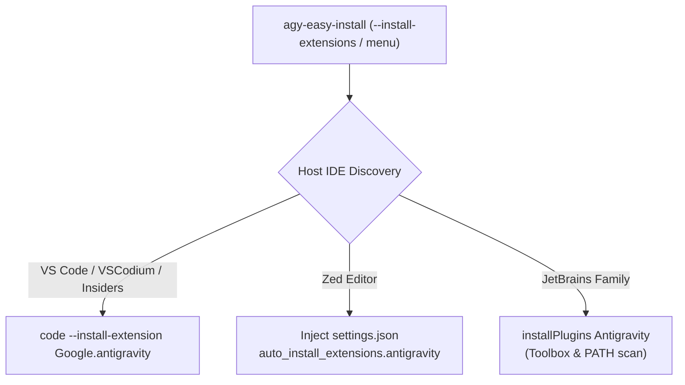

# Package Specification: Antigravity IDE & Modern Editor Extensions

> **Status:** ✅ Active & Expanded  
> **Last updated:** 2026-10-10  
> **Parent:** [implementation_plan.md](implementation_plan.md) · [master-plan.md](master-plan.md)

---

## Overview

The Antigravity development experience operates across a dual-track architecture:

1. **Standalone Antigravity IDE:** A dedicated desktop application designed for secure, turnkey agentic software engineering education and sandboxed lab environments. It bundles the Gemini-powered agent canvas, interactive terminal shells, debugging hooks, and course track viewers into an integrated Electron/Web shell.
2. **Modern Editor Extensions (Ecosystem Transition):** To support professional developers, enterprise engineers, and diverse development workflows, Antigravity has transitioned to first-class integrations inside existing modern editors—specifically **Visual Studio Code**, **Zed**, and the **JetBrains IDE family**—via official Antigravity extensions and plugins.

`agy-easy-install` provides seamless installation and configuration for both tracks.

---

## Track A: Standalone Antigravity IDE

### Package Metadata

| Property | Value / Description |
|---|---|
| **Package Name** | `google-antigravity` (generic), `antigravity` (Homebrew/System Repos) |
| **Binary Name** | `antigravity` |
| **Target Audience** | Students, educational institutions, managed lab environments |
| **GUI Framework** | Electron / Native Web Shell |
| **Release Stream** | Google Cloud Storage releases (`antigravity-linux-x64-*.tar.gz`, macOS `.dmg`, Windows `.exe`) |

### Target Installation Directories

The installation targets depend on the chosen installation method and operating system:

#### 1. Homebrew (macOS / Linux)
- **macOS:** `/Applications/Google Antigravity.app` (cask)
- **Linux:** `/home/linuxbrew/.linuxbrew/bin/antigravity` (formula symlink pointing to the cellar extraction)

#### 2. System Repo (Debian / Ubuntu / Fedora)
- **Executable:** `/usr/bin/antigravity`
- **Application Directory:** `/usr/share/antigravity`
- **Icon Assets:** `/usr/share/icons/hicolor/scalable/apps/antigravity.svg`
- **Desktop Entry:** `/usr/share/applications/google-antigravity.desktop`

#### 3. Official Binary (Standalone Tarball)
- **User-Space Executable:** `~/.local/bin/antigravity`
- **Application Directory:** `~/.local/lib/antigravity/`
- **Desktop Entry:** `~/.local/share/applications/google-antigravity.desktop` and `~/Desktop/google-antigravity.desktop`

### Chrome Browser Runtime Dependency

Antigravity operates via Chrome Developer Protocol (CDP) and requires a modern Google Chrome engine:
- **Homebrew Cask:** Automatically verifies or installs the `google-chrome` dependency.
- **Tarball / System Repo:** The installer scans for Chrome installations across standard paths, `/opt/google/chrome`, Flatpak (`com.google.Chrome`), and Snap, saving the path mapping to `~/.config/Antigravity`.

---

## Track B: Modern Editor Extensions (First-Class IDE Integration)

Rather than forcing users into a standalone IDE shell, `agy-easy-install` provides automated extension installation across major modern code editors.



### 1. Visual Studio Code & Variants

* **Target Editors:** Visual Studio Code (`code`), VS Code Insiders (`code-insiders`), and VSCodium (`codium`).
* **Extension Identifier:** `Google.antigravity`
* **Installation Mechanism:**
  ```bash
  code --install-extension Google.antigravity --force
  ```
* **CLI Flag:** `--install-vscode`
* **Features:** Full agent canvas side panel, interactive diff reviews, MCP tool integration, and workspace telemetry.

### 2. Zed Editor

* **Target Editor:** Zed (`zed`), high-performance Rust-based editor.
* **Configuration Target:**
  * **Linux:** `~/.config/zed/settings.json`
  * **macOS:** `~/Library/Application Support/Zed/settings.json`
* **Installation Mechanism:**
  Idempotently configures `settings.json` using Python/jq JSON merging:
  ```json
  {
    "auto_install_extensions": {
      "antigravity": true
    }
  }
  ```
* **CLI Flag:** `--install-zed`
* **Features:** Real-time collaborative agent editing, sub-millisecond input latency, and native Rust LSP bindings.

### 3. JetBrains IDE Family

* **Target Editors:** IntelliJ IDEA (`idea`), PyCharm (`pycharm`), WebStorm (`webstorm`), GoLand (`goland`), CLion (`clion`), PhpStorm (`phpstorm`), Rider (`rider`), and RubyMine (`rubymine`).
* **Discovery Paths:**
  1. Active executables in `$PATH`
  2. JetBrains Toolbox user installations (`~/.local/share/JetBrains/Toolbox/apps/` and macOS `~/Library/Application Support/JetBrains/Toolbox/apps/`)
* **Installation Mechanism:**
  ```bash
  <ide-binary> installPlugins Antigravity
  ```
* **CLI Flag:** `--install-jetbrains`
* **Features:** Deep PSI code analysis hooks, native refactoring integration, and tool window docking.

### 4. Unified Multi-Editor Installer

* **Command:** `antigravity-manager.sh --install-extensions`
* **Interactive Menu:** Accessible under `ide_extensions_submenu` in the terminal UI.
* **Behavior:** Automatically scans for all supported editors installed on the host and configures their respective Antigravity extensions in a single pass.

---

## Maintenance & Version Rules

1. **Auto-Updates:**
   - Standalone packages installed via Homebrew and System Repos (`apt`/`dnf`) are updated through their respective package managers.
   - Standalone binary/tarball installations are updated by running `antigravity-manager.sh` or via the self-update mechanism.
   - VS Code, Zed, and JetBrains extensions follow their respective marketplace auto-update lifecycles.
2. **Version Pinning & Scraper:**
   - The default IDE version constant (`DEFAULT_IDE_VERSION`) in `src/00_config.sh` tracks the latest validated release published in `versions.json`.
   - Nightly scraper automation (`scrape_latest.py`) validates new releases and checksums before updating the configuration.
